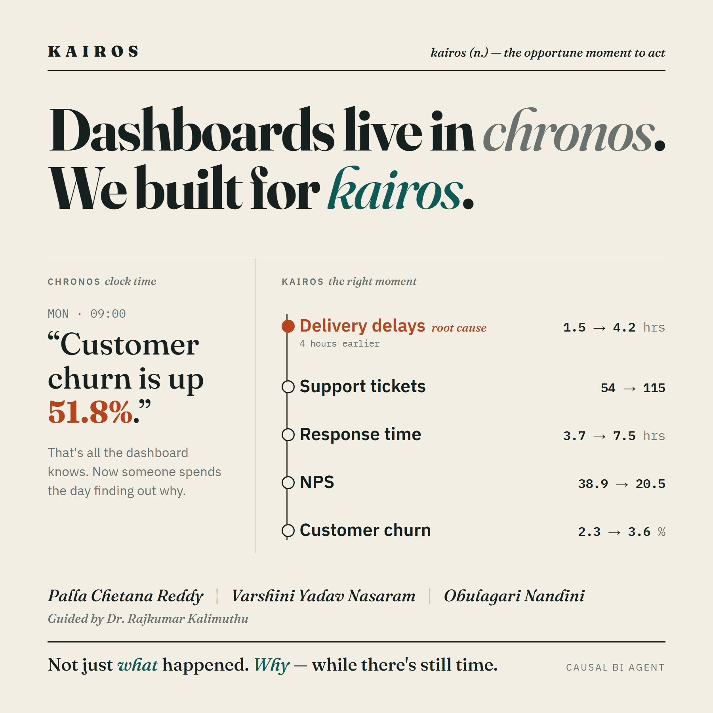
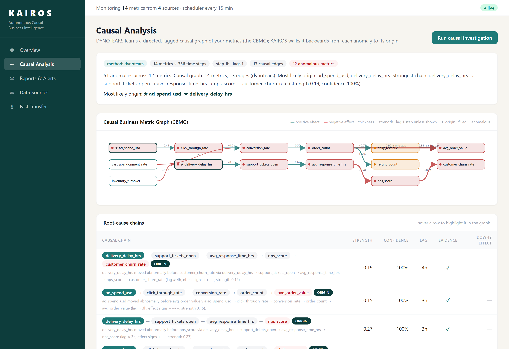
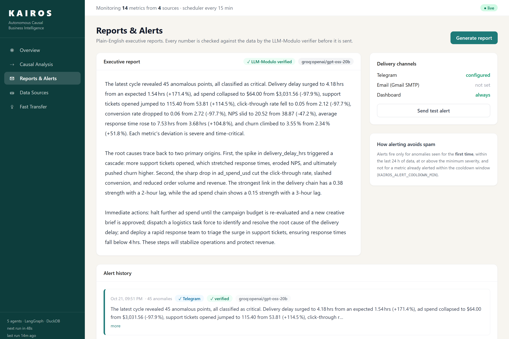
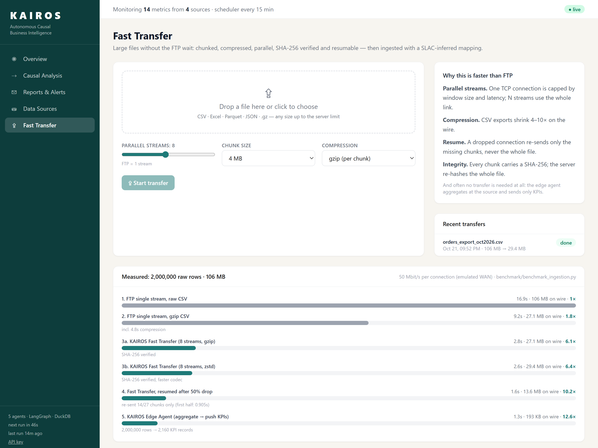
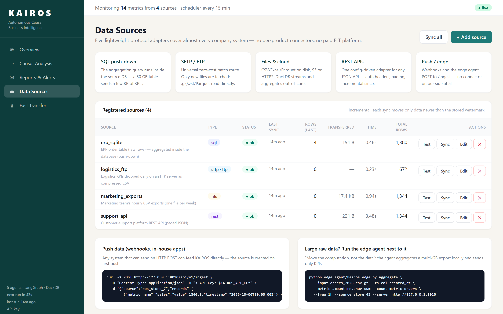
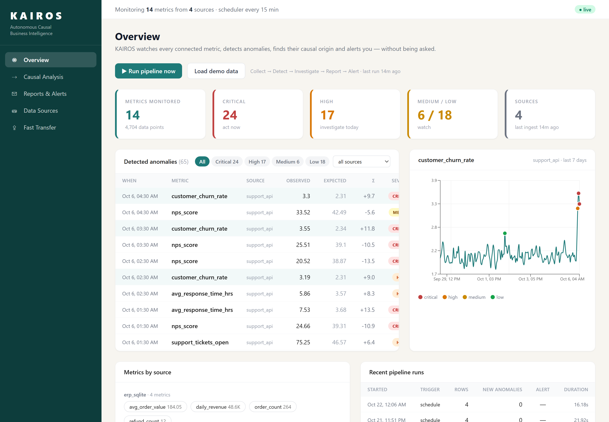
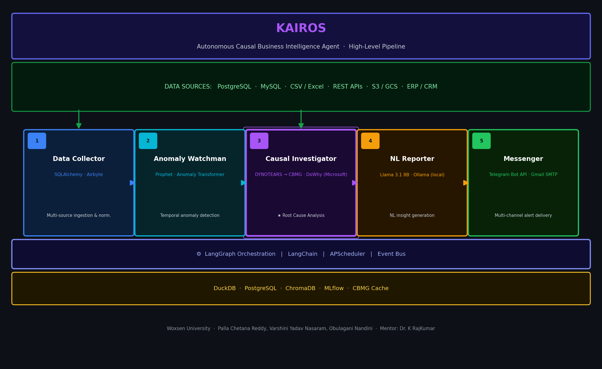

# KAIROS — Autonomous Causal Business Intelligence Agent

<div align="center">



**An Autonomous Causal Business Intelligence Agent for Proactive Multi-Source Metric Monitoring and Root Cause Analysis**

[](https://python.org)
[](https://react.dev)
[](tests/)
[](LICENSE)
[]()
[]()

> *"Power BI answers questions when you ask. KAIROS asks the questions for you."*

</div>

---

## What is KAIROS?

Every BI tool today (Power BI, Tableau, Looker, ThoughtSpot) waits for a human to open it and ask a
question. If nobody looks, nobody knows anything is wrong.

**KAIROS** is a five-agent autonomous pipeline that, every 15 minutes and without being asked:

1. **Collects** metrics from any source (SQL, SFTP/FTP, files and cloud storage, REST APIs, Google Sheets, push/webhooks), incrementally.
2. **Detects** anomalies with a seasonal robust z-score + Prophet ensemble.
3. **Investigates** their *causal* origin with **DYNOTEARS** temporal causal discovery, not correlation.
4. **Explains** them in plain English with an LLM whose every number is checked by an **LLM-Modulo** verifier.
5. **Delivers** alerts to Telegram, e-mail and the dashboard, with no duplicates and no spam.

Total deployment cost: **₹0** (open-source stack, free-tier LLM, optional local LLM).

---

## Screenshots

| Causal Analysis: graph and root-cause chains | Verified report and alert history |
|---|---|
|  |  |
| **Fast Transfer: chunked, parallel, SHA-256 verified** | **Data Sources: SQL, SFTP/FTP, files, REST** |
|  |  |



---

## Novel contributions

| Contribution | What it is | Where |
|---|---|---|
| **ProBI**: Proactive BI | Autonomous monitoring loop with first-sighting anomaly tracking and alert gating (new + recent + severity + cooldown) | `backend/pipeline.py`, `agents/anomaly_watchman.py` |
| **CBMG**: Causal Business Metric Graph | DYNOTEARS (implemented from the paper in numpy/scipy) learns a directed, lagged causal graph of KPIs; bootstrap edge confidence; root causes ranked by strongest path and temporal precedence; DoWhy effect estimates | `models/dynotears.py`, `models/cbmg.py`, `agents/causal_investigator.py` |
| **SLAC**: Semantic Layer Auto-Construction | Infers mapping (timestamp, long/wide, metric columns, raw→aggregate) and business semantics (unit, category, higher-is-better) for any new source, with an LLM + deterministic fallback | `models/slac.py` |
| **Smart ingestion layer** | 5 protocol adapters instead of per-product connectors; SQL push-down; SFTP/FTP new-file tracking; edge agent; **KAIROS Fast Transfer** (chunked, parallel, compressed, resumable, SHA-256) | `connectors/`, `services/transfer.py`, `edge_agent/` |

**Evaluation on data with a known causal ground truth** (`backend/demo/synthetic.py`, 15 metrics, 4 sources):

- DYNOTEARS recovers **11 of 12 true causal edges with 0 false edges** (precision 1.00, recall 0.92, F1 0.96).
- Every recovered edge has the correct direction, lag and sign.
- Both injected incident origins are identified.

(`tests/test_core.py`, `notebooks/03_causal_analysis.ipynb`.)

---

## Architecture

```
 SQL DB ─┐  SFTP/FTP ─┐  Files/S3 ─┐  REST API ─┐  Sheets ─┐  Push / Edge agent / Fast Transfer ─┐
         └────────────┴────────────┴────────────┴──────────┴────────────────────────────────────┘
                                              │  incremental (watermarks), parallel, push-down
                         AGENT 1  Data Collector  ── SLAC mapping ──►  DuckDB (idempotent upserts)
                                              │
                         AGENT 2  Anomaly Watchman   robust z (seasonal) + Prophet → anomalies table
                                              │  only NEW, recent, ≥ severity, not in cooldown
                         AGENT 3  Causal Investigator   DYNOTEARS → CBMG → root-cause chains → DoWhy
                                              │
                         AGENT 4  NL Reporter   Groq / Ollama draft → LLM-Modulo verifier → template fallback
                                              │
                         AGENT 5  Messenger   Telegram · Gmail · dashboard (history persisted)

        LangGraph state machine · APScheduler (background thread) · FastAPI · React dashboard
```



---

## Tech stack (100% free)

| Layer | Tools |
|---|---|
| Orchestration | LangGraph state machine, APScheduler |
| API | FastAPI, Pydantic, optional API-key auth |
| Storage | DuckDB (embedded, columnar, out-of-core) |
| Ingestion | SQLAlchemy, DuckDB httpfs (S3/GCS/HTTPS), paramiko (SFTP), ftplib (FTP/FTPS), httpx (REST), gspread |
| Anomaly detection | Seasonal robust z-score (MAD), Prophet |
| Causal discovery | DYNOTEARS (own implementation), VARLiNGAM (causal-learn) & Granger fallbacks, DoWhy |
| LLM | Groq free tier (`openai/gpt-oss-20b`) → local Ollama (`llama3.1:8b`) → grounded template |
| Frontend | React 18, Vite, Tailwind CSS, Recharts, custom SVG causal graph |
| Alerts | Telegram Bot API, Gmail SMTP |
| Deployment | Docker (single container: API + dashboard), Render / Vercel free tiers |

---

## Repository structure

```
kairos/
├── backend/
│   ├── agents/            data_collector · anomaly_watchman · causal_investigator · nl_reporter · messenger
│   ├── connectors/        base (contract + mapping) · sql · file · sftp (SFTP/FTPS/FTP) · rest · sheets · registry
│   ├── models/            anomaly (ensemble) · dynotears · cbmg · slac
│   ├── services/          transfer (Fast Transfer) · ingest (files → metrics)
│   ├── api/               routes (core) · sources · ingest (push, upload, transfer) · deps (auth)
│   ├── demo/synthetic.py  multi-source data with known causal ground truth
│   ├── config.py · db.py · pipeline.py · main.py · requirements.txt
├── frontend/src/          Overview · Causal Analysis (CBMG graph) · Reports & Alerts · Data Sources · Fast Transfer
├── edge_agent/            kairos_edge.py: aggregate locally & push KPIs, or fast-transfer files
├── benchmark/             benchmark_ingestion.py + results/ (FTP vs Fast Transfer vs edge agent)
├── scripts/               generate_demo_sources.py · demo_servers.py (FTP + REST demo systems)
├── tests/                 connectors (real FTP & HTTP servers) · core · transfer · API end-to-end
├── notebooks/             01 data exploration · 02 anomaly detection · 03 causal analysis
├── research/              literature_review.md · gap_analysis.md
├── docs/                  INGESTION.md (review answers) · API.md · assets/
├── sources.example.yaml   every connector type, documented
├── Dockerfile · docker-compose.yml · .env.example · LICENSE
```

---

## Getting started

### Prerequisites
- Python 3.11+ (tested on 3.13), Node.js 18+
- Optional: [Ollama](https://ollama.com) for a local LLM, Docker

### 1. Configure
```bash
cp .env.example .env          # all settings optional for a local demo
```

### 2. Backend
```bash
python -m venv backend/venv
backend\venv\Scripts\activate            # Windows   (source backend/venv/bin/activate on macOS/Linux)
pip install -r backend/requirements.txt
uvicorn backend.main:app --reload        # run from the repository root → http://127.0.0.1:8000/docs
```

### 3. Frontend
```bash
cd frontend && npm install && npm run dev   # http://localhost:5173
```

### 4. See it work
- **Quick:** click **Load demo data** on the Overview page. That loads 2 weeks of data from 4 sources, with incidents, and runs the pipeline.
- **Live connectors:** follow the 5-minute demo in [`docs/INGESTION.md`](docs/INGESTION.md#7-live-demo-script-5-minutes):
  ```bash
  python scripts/generate_demo_sources.py   # ERP (SQLite), CSV exports, FTP drop, REST API + sources.yaml
  python scripts/demo_servers.py            # FTP :2121 and REST :8090
  ```

### Docker (API + dashboard in one container)
```bash
docker compose up --build                 # http://localhost:8000
docker compose --profile demo up          # + a real SFTP server for the SFTP connector demo
```

### Optional: LLM reports and alerts
- Free Groq key: [console.groq.com](https://console.groq.com) → `GROQ_API_KEY`
- Local LLM: `ollama pull llama3.1:8b`
- Telegram: message @BotFather → `/newbot` → `TELEGRAM_BOT_TOKEN`, `TELEGRAM_CHAT_ID`

Without an LLM, KAIROS writes grounded template reports.

---

## Data ingestion: "data can come from any source"

KAIROS **moves metrics, not datasets.** In short (full answer in [`docs/INGESTION.md`](docs/INGESTION.md)):

- **5 protocol adapters**, not hundreds of product connectors. Configured, not coded; SLAC infers each new schema.
- **SFTP/FTP supported** and kept fast: only new, compressed, small KPI files are fetched.
- **Large data:**
  - aggregation runs inside the source DB (SQL push-down)
  - or next to the files (edge agent)
  - or DuckDB reads only the needed Parquet columns from S3
- **Large files that must move:** KAIROS Fast Transfer (chunked, parallel, compressed, resumable, SHA-256 verified).

Benchmark on a 2M-row (≈106 MB) export: [`benchmark/results/results.md`](benchmark/results/results.md).

```bash
# push only KPIs from a huge local export
python edge_agent/kairos_edge.py aggregate --input orders.csv.gz --ts-col created_at \
    --metric amount:revenue:sum --count-metric orders --source store_42
# or move the raw file fast
python edge_agent/kairos_edge.py transfer --file warehouse.parquet --workers 8 --compress zstd --ingest
```

---

## Testing & benchmark

```bash
python -m pytest tests -q                              # connectors, core, transfer, API end-to-end
python benchmark/benchmark_ingestion.py --rows 2000000 --stream-mbps 50
```

The tests run a real FTP server and a real HTTP server, so they need no network access and send
nothing to Telegram or the LLM.

---

## API

Interactive docs are at `/docs`. Summary in [`docs/API.md`](docs/API.md).

| Area | Endpoints |
|---|---|
| Pipeline | `POST /api/v1/pipeline/run` · `GET /pipeline/runs` · `GET /status` |
| Metrics & anomalies | `GET /metrics` · `GET /metrics/{m}/series` · `GET /anomalies` · `POST /anomalies/detect` |
| Causal & reports | `POST /investigate` · `GET /investigation/latest` · `POST /report` · `GET /alerts/history` |
| Sources | `GET/POST /sources` · `POST /sources/test` · `POST /sources/{name}/sync` · `GET /connectors` |
| Ingest | `POST /ingest` (push) · `POST /files` · `POST /files/{id}/ingest` |
| Fast Transfer | `POST /transfer/start` · `PUT /transfer/{id}/chunk/{n}` · `GET /transfer/{id}` · `POST /transfer/{id}/complete` |

---

## Evaluation datasets

| Dataset | Use |
|---|---|
| Synthetic multi-source KPIs with known causal graph (`backend/demo/synthetic.py`) | Detection + causal discovery accuracy (precision/recall/SHD) |
| [Olist Brazil E-Commerce](https://www.kaggle.com/datasets/olistbr/brazilian-ecommerce) | End-to-end on real raw orders: upload via Fast Transfer, and SLAC aggregates to KPIs |
| Superstore Sales, Northwind | Multi-table analytics through the SQL connector |

---

## Research

Capstone Project-I, Woxsen University, School of Technology.
Literature review and gap analysis: [`research/`](research/).
**Target publication:** KDD 2027 Applied Data Science Track / VLDB 2027 Industrial Track.

Key papers:
- [ReAct (ICLR 2023)](https://arxiv.org/abs/2210.03629)
- [DYNOTEARS (AISTATS 2020)](https://arxiv.org/abs/2002.00498)
- [NOTEARS (NeurIPS 2018)](https://arxiv.org/abs/1803.01422)
- [Anomaly Transformer (ICLR 2022)](https://arxiv.org/abs/2110.02642)
- [LLM-Modulo (ICML 2024)](https://arxiv.org/abs/2402.01817)
- [AIDA (arXiv 2026)](https://arxiv.org/abs/2605.07202)

---

## Team

- Palla Chetana Reddy
- Varshini Yadav Nasaram
- Obulagari Nandini

Guided by **Dr. Rajkumar Kalimuthu**.

## License

MIT; see [LICENSE](LICENSE).
